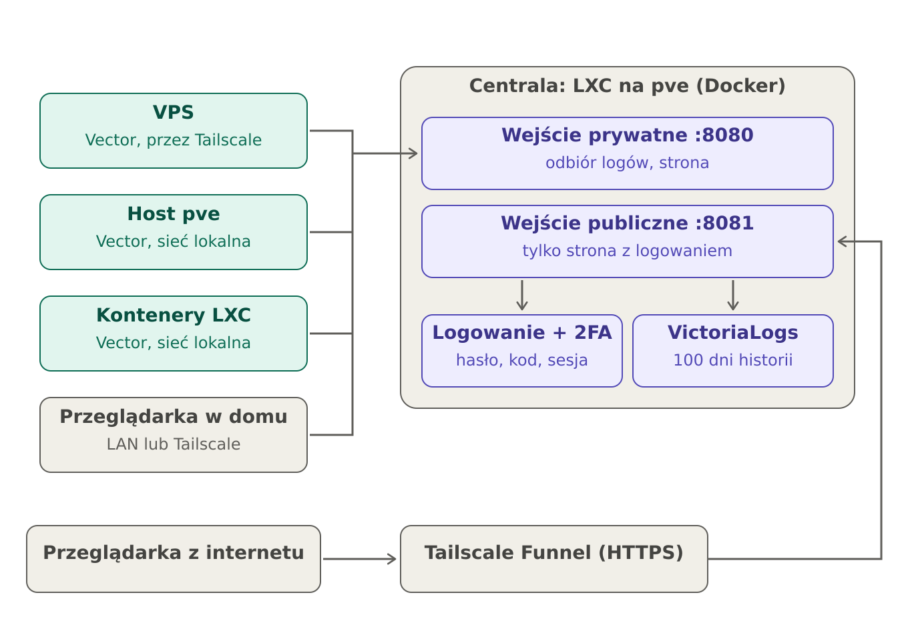

# loghub

Logi ze wszystkich serwerów w jednym miejscu: lekka strona w przeglądarce, logowanie hasłem i kodem 2FA,
podgląd zadań cron z kodami wyjścia. Dane między maszynami idą po Tailscale albo sieci lokalnej;
na świat można wystawić samą stronę z logowaniem.



## Co gdzie działa

| Część | Gdzie | Z czego |
|---|---|---|
| Centrala | kontener LXC na Proxmoxie (albo dowolna maszyna z Dockerem) | VictoriaLogs (baza logów, 100 dni), Caddy (dwa wejścia), `auth.py` (logowanie + 2FA) |
| Agent | każda obserwowana maszyna | Vector jako usługa systemd; czyta journald, `/var/log/**/*.log`, logi Dockera, wyniki crona |
| Strona | serwowana przez centralę | jeden plik `hub/www/index.html`, bez bibliotek |

Wejścia centrali:

- **8080, prywatne** (sieć lokalna i Tailscale): agenci wysyłają tu logi (z tokenem), ludzie oglądają stronę.
- **8081, publiczne** (tylko przez Tailscale Funnel): sama strona z logowaniem. Nie przyjmuje logów.

## Instalacja

### 1. Centrala na Proxmoxie

Na hoście Proxmox, jako root:

```bash
curl -fsSL https://raw.githubusercontent.com/Seelf/loghub/main/proxmox.sh | bash
```

Skrypt tworzy nieuprzywilejowany kontener LXC (Debian 12), instaluje w nim Dockera, Tailscale i centralę,
wypisuje hasło administratora i pyta, czy od razu zainstalować agenta na hoście i we wszystkich działających
kontenerach LXC. Przy Tailscale pojawi się link do zalogowania (albo podaj `TS_AUTHKEY=tskey-auth-...`).

Bez GitHuba: skopiuj ten katalog na hosta i uruchom `bash proxmox.sh`.

Ustawienia (zmienne przed poleceniem): `CTID`, `CT_NAME`, `STORAGE`, `DISK`, `MEMORY`, `CORES`, `BRIDGE`,
`IP=192.168.1.50/24 GW=192.168.1.1`, `AGENT=0`. Przy DHCP zarezerwuj adres kontenera w routerze.

### 1b. Centrala na zwykłej maszynie z Dockerem

```bash
curl -fsSL https://raw.githubusercontent.com/Seelf/loghub/main/install.sh | sudo bash -s -- hub
```

### 2. Agent na maszynach poza domem (np. VPS)

Centrala po instalacji wypisuje gotową komendę z tokenem i swoim adresem w Tailscale:

```bash
curl -fsSL https://raw.githubusercontent.com/Seelf/loghub/main/install.sh | sudo bash -s -- agent \
  --hub http://ADRES_TAILSCALE_CENTRALI:8080 --token TOKEN
```

Agent sam instaluje Tailscale i Vectora (gdy Tailscale już działa, dodaj `--no-tailscale`). Na maszynie nie trzeba
otwierać żadnego portu. Logi TeamSpeak 3 (`ts3server_*.log`) w /opt, /srv, /home, /root są wykrywane same.
Opcje: `--name NAZWA`, `--logs "/opt/ts3/logs/*.log,/srv/app/*.log"`, `--no-cron`, `--no-status`, `--no-lxc`, `--no-tailscale`.

Aktualizacja: uruchom tę samą komendę jeszcze raz; nadpisze konfigurację agenta.

### 3. Pierwsze logowanie

Otwórz `http://ADRES_CENTRALI:8080`, zaloguj się jako `admin` hasłem z instalacji. Strona pokaże klucz do
aplikacji z kodami (Aegis, Google Authenticator); po wpisaniu pierwszego kodu 2FA jest włączone.

### 4. Strona dostępna z internetu

W kontenerze centrali (`pct exec ID -- ...`):

```bash
loghub public on       # sama strona z logowaniem, HTTPS przez Tailscale Funnel
loghub public status
loghub public off
```

Funnel wymaga włączonego HTTPS i Funnel w panelu Tailscale; polecenie poda link, jeśli czegoś brakuje.

## Polecenia na centrali

```bash
loghub user add NAZWA [--role admin|viewer] [--hosts pve,vps]   # hasło generuje się samo, 2FA przy pierwszym logowaniu
loghub user hosts NAZWA pve,vps|all                         # które maszyny widzi oglądający
loghub user list | del NAZWA | passwd NAZWA | reset-2fa NAZWA
loghub public on | off | status
```

Podgląd strony na przykładowych danych: `http://ADRES_CENTRALI:8080/?demo`.

## Usuwanie agenta

```bash
loghub uninstall-agent
```

Usuwa Vectora, usługę `loghub-cron` i wpis w `/etc/default/cron`. Tailscale zostaje.

## Stan usług i zasoby

Usługa `loghub-status` co minutę wysyła CPU, RAM, dysk i obciążenie maszyny, stan kontenerów Dockera
(z `docker stats`), stan usług systemd, a na hoście Proxmox także listę kontenerów LXC i VM z ich zużyciem.
Na stronie: kolorowe kropki (działa / zatrzymane / padło), wskaźniki na kartach serwerów i zakładka Zasoby.

## Konta i dostęp

Konta zakłada się w przeglądarce (Użytkownicy, tylko administrator) albo poleceniem `loghub user`. Każde konto
loguje się hasłem i kodem 2FA. Oglądający widzi tylko zaznaczone maszyny: usługa logowania pośredniczy w każdym
zapytaniu do bazy i dokleja filtr maszyn (`extra_stream_filters`), którego nie da się obejść treścią zapytania.
Zmiana dostępu działa od razu.

## Stan, zasoby i drzewo maszyn

Usługa `loghub-status` co ok. 20 s wysyła CPU, RAM, dysk, obciążenie, stan kontenerów Dockera i usług systemd,
a na hoście Proxmox także listę LXC i VM z ich zużyciem. Do tego wszystkie zamontowane dyski i udziały,
pule ZFS, stan SMART fizycznych dysków (co 10 min, na maszynach fizycznych; agent doinstalowuje smartmontools)
oraz nasłuchujące porty TCP/UDP z nazwą procesu i reguły zapory ufw otwarte na świat. Strona odświeża zasoby co 15 s.
Maszyny będące kontenerami LXC/VM Proxmoxa pokazują się w drzewie pod swoim hostem (dopasowanie po nazwie).

## Powiadomienia

Usługa `notify` na centrali co minutę sprawdza: brak kontaktu z maszyną, padnięte kontenery i usługi, błędy
zadań cron, zapełnienie każdego dysku, awarię dysku (SMART) i pule ZFS poza stanem ONLINE, wysokie CPU i RAM,
port nowo otwarty na świat w zaporze ufw (jedno powiadomienie z oknem czasowym zmiany) albo wyłączenie ufw,
nagły wysyp błędów w logach. Kanały: ntfy, Telegram, Discord,
webhook, e-mail. Ustawienia: zakładka Powiadomienia (tylko administrator).

## Zadania cron

Agent ustawia cronowi opcję `-L 15` (w `/etc/default/cron`), dzięki której cron zapisuje koniec i kod wyjścia
każdego zadania. Usługa `loghub-cron` składa te wpisy w jeden rekord na uruchomienie i co 10 minut sprawdza
listę zadań w crontabach. Działa z cronem z Debiana, Ubuntu i Proxmoxa. Crontaby nie są modyfikowane.

## Bezpieczeństwo

- Hasła jako scrypt, sesja w podpisanym ciasteczku (HttpOnly, SameSite=Strict), blokada po 5 złych próbach,
  kod 2FA działa tylko raz.
- Agenci mają token tylko do zapisu logów; nie mogą niczego odczytać.
- Strona i logowanie to własny kod tego projektu, bez zewnętrznego audytu. Zanim włączysz `public on`,
  sprawdź całość w sieci lokalnej i przez Tailscale.
- Repozytorium nie zawiera żadnych sekretów; tokeny i hasła powstają przy instalacji i zostają na centrali
  (`/opt/loghub/.env`, `/opt/loghub/authdata/`).

## Pliki

```
install.sh            instalator centrali i agenta; po instalacji dostępny jako polecenie `loghub`
proxmox.sh            tworzy kontener LXC z centralą na Proxmoxie
hub/www/index.html    strona
hub/www/demo.js       przykładowe dane dla ?demo
hub/auth/auth.py      logowanie, 2FA, konta
hub/notify/notify.py  powiadomienia
docs/                 diagram
```
